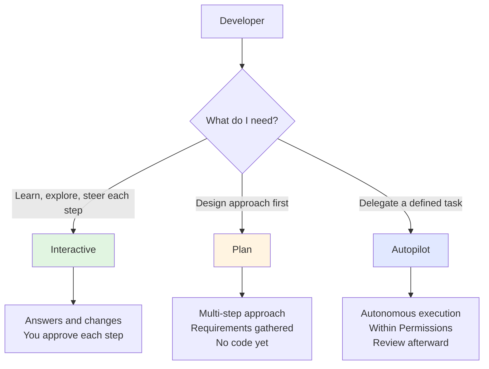
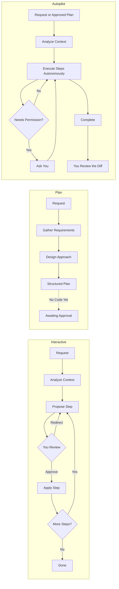
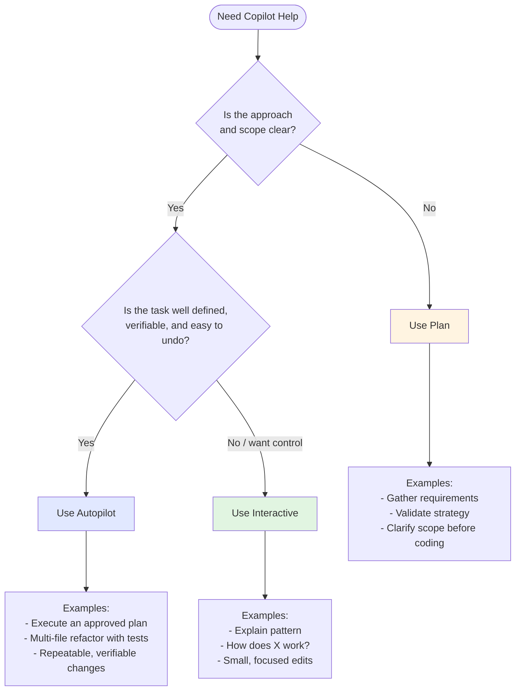
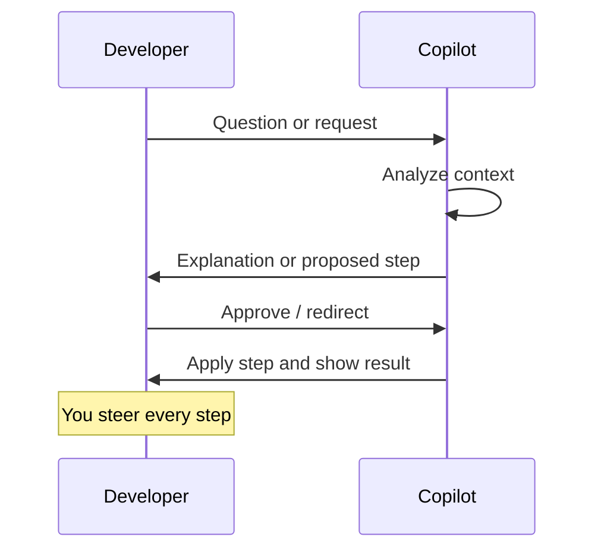
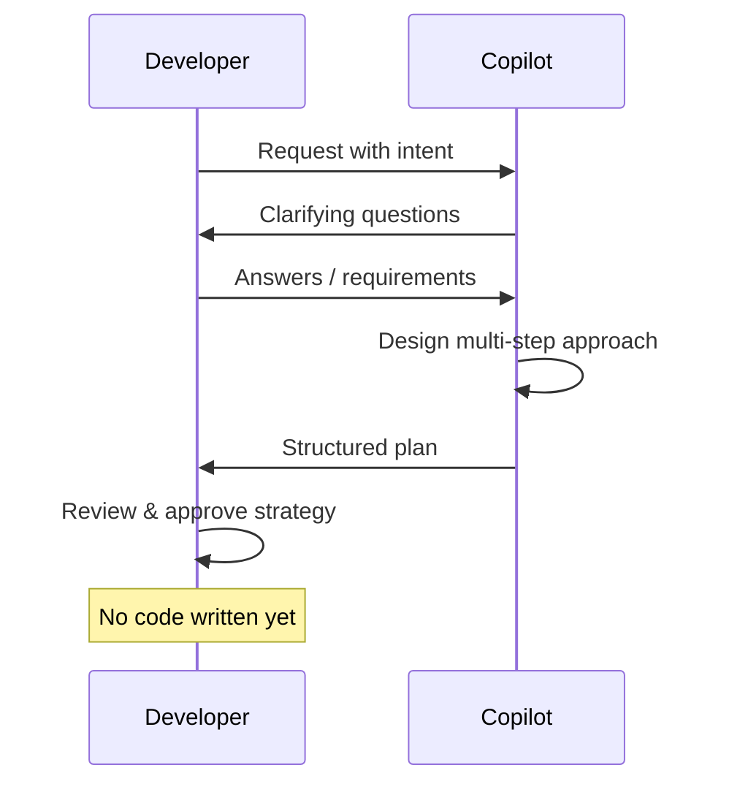
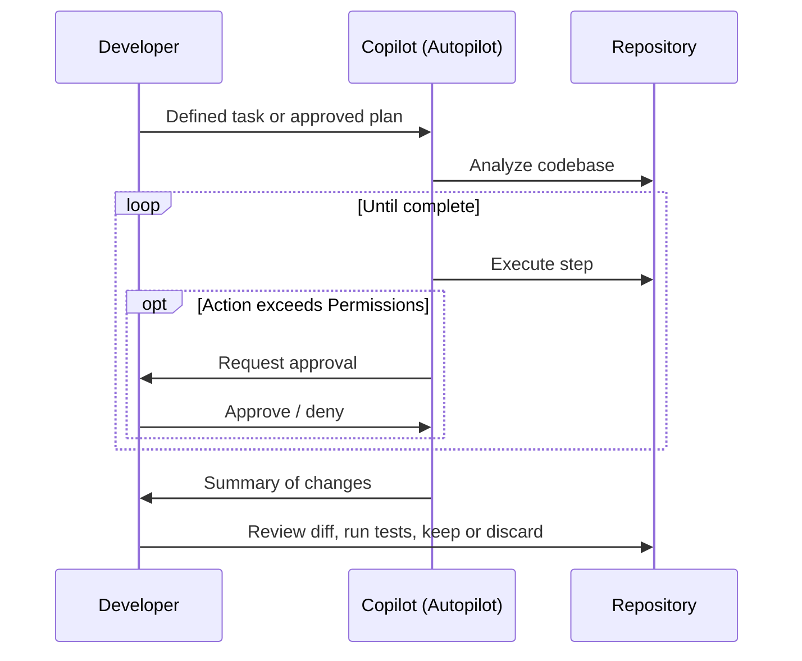

# Copilot Interaction Models

This diagram illustrates the three agent modes in GitHub Copilot (VS Code) and when to use each. Select a mode from the **Agent mode** picker below the chat box.

> **Separate controls:** *Agent mode* decides **how** Copilot works, *Permissions* decides **what** it may do without asking, and the *Agent picker* decides **who** does the work (custom agents). The former Ask and Edit modes are gone; a question is simply a prompt in Interactive mode.

## Interaction Models Overview

## Mode Comparison

## Decision Tree: Which Mode to Use?

## Interaction Characteristics

| Characteristic | Interactive | Plan | Autopilot |
|----------------|-------------|------|-----------|
| **Primary Purpose** | Collaborate step by step | Design & Clarify | Execute autonomously |
| **Output Type** | Answers + approved changes | Structured Plan | Completed changes |
| **Code Generated** | Yes, as you approve | None (plan only) | Yes, within Permissions |
| **Scope** | Focused to multi-file | Requirements gathering | Multi-file, repository-level |
| **Control Level** | Highest (every step) | High (approve plan) | Lowest (review afterward) |
| **Speed** | Deliberate | Fast | Fastest end to end |
| **Best For** | Learning, focused edits | Strategy validation | Well-defined implementation |

## Usage Patterns

### Interactive Flow

### Plan Flow

### Autopilot Flow

## Key Principle

> **Autonomy is a dial, not a switch**
> Choose the least autonomy that fits the job. Plan first when unsure, then hand off to Autopilot with Permissions you are comfortable with.

## When Plan Shines

✅ Requirements are unclear and need clarifying before coding  
✅ You want to validate the approach before committing  
✅ Complex feature with multiple design options  
✅ Onboarding — understanding what needs to change before changing it  

## When Autopilot Shines

✅ Executing an approved plan  
✅ Multi-file refactoring covered by tests  
✅ Repeatable, easy-to-verify changes on a branch  
✅ Work where review afterward is cheaper than approving each step  

---

## See Also

- [Lab 05: Interaction Models](../../labs/lab-05-interaction-models.md)
- [Agent Workflow Patterns](agent-workflow-patterns.md)
- [Agent vs Instructions vs Prompts](agent-vs-instructions-vs-prompts.md)
